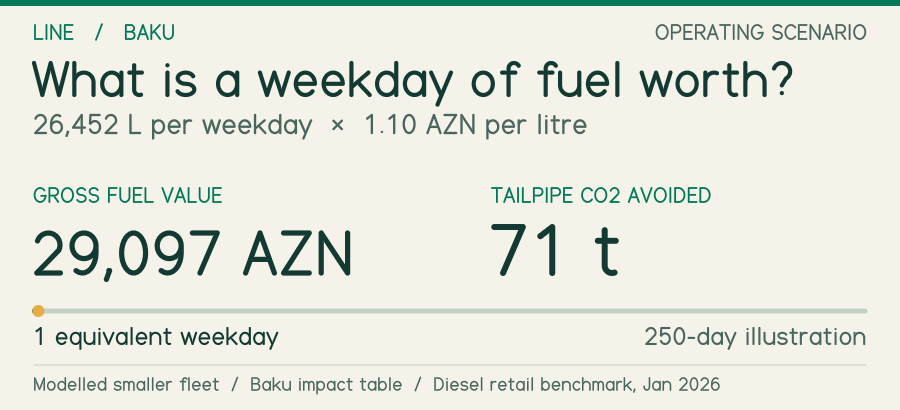

# Line · Better bus service with the buses a city already owns

On Baku bus route **114B, 92% of the stops are also served by 114A**. Should a planner merge the routes and move buses to where people wait longer? A map shows the overlap. To make the decision, the planner also needs to know who gets home sooner, who loses a nearby stop, and what the operator could save. I built Line to answer those questions one route change at a time. [The Baku change log](output/redesign/changes.csv)

**In Baku, one modelled redesign offers a choice.** Keep today's bus-hours and save **1,268 rider-hours per 100,000 journeys**. Or reduce service while matching today's average journey time and save **26,452 diesel-equivalent litres and 70.6 tonnes of tailpipe CO₂ per weekday**. At Azerbaijan's retail diesel benchmark, the second option represents **AZN 7.27 million in gross annual fuel value** if the city achieves the modelled reduction on 250 equivalent weekdays. These are estimates from a research model. [Before-and-after results](output/redesign/impact.csv) · [Valuation and assumptions](#what-the-baku-results-are-worth)

I’m Ismat Samadov, an independent researcher in Baku. The research software, results and maps are available today. I want to turn them into a planning application and test its recommendations with a bus operator. **I’m seeking a transit partner with operating data and an investment partner to fund that first trial.** [Proposed pilot](#the-application-and-its-first-customer) · [Contact me](mailto:ismetsemedov@gmail.com) · [Research manuscript](paper/manuscript.md)

## The decision facing Baku

Across **201 routes and 3,456 served stops**, eight or more routes share every link on 21 stretches totalling 71 km. Overlap can be useful on a busy corridor. The question is whether the next bus is worth more there or on a route where a long wait dominates the trip. Line tests mergers, detour removal, stop spacing and bus reallocation against the time a rider spends walking, waiting, transferring and riding. [Corridor measurements](output/corridors.csv) · [Search method](docs/redesign.md)


The map replays the **27 changes** selected on the trips used to design the network. The figures below come from a separate set of trips reserved for evaluation. The second option runs the redesigned routes less often until the average trip approximately matches the baseline. Both columns describe the same Baku network under different operating decisions. [Evaluation method](docs/methodology.md) · [Route-by-route results](output/redesign/routes.csv)

| On a modelled Baku weekday | Baseline | Keep today's bus-hours | Match today's mean trip |
|---|---:|---:|---:|
| Average door-to-door minutes, counting unreachable trips at 120 min | 74.82 | **74.06** | **74.77** |
| Average minutes for trips possible within 120 min | 51.93 | 50.96 | 51.77 |
| Bus-hours | 28,327 | 28,327 | **25,007** |
| Buses in service, rounded up separately for each route | 2,015 | 2,017 | **1,796** |
| Diesel-equivalent litres | 226,592 | 226,708 | **200,140** |
| Tailpipe CO₂, tonnes | 605.0 | 605.3 | **534.4** |
| Residents within 400 m of a served stop, straight line | 2,007,349 | 2,002,313 | 2,002,313 |

At the same bus-hours, reallocating service saves riders time while slightly **increasing** modelled fuel use. With fewer bus-hours, the operator frees the equivalent of **219 buses** after rounding by route. Both plans leave about **5,036 fewer residents within 400 m** of a stop. An average trip time can hide a much longer walk for one neighbourhood. [Impact table](output/redesign/impact.csv) · [Coverage and route checks](docs/results.md#check-these-before-acting)

## What the Baku results are worth



| Who receives the benefit? | Calculation using the modelled weekday | Annual illustration at 250 equivalent weekdays |
|---|---|---:|
| **Operator · fuel budget** under the smaller-fleet option | 26,451.72 diesel-equivalent L saved × AZN 1.10/L ≈ AZN 29,097/day | **AZN 7.27m** gross fuel value |
| **Public · climate impact** under the same option | 70.6261 t tailpipe CO₂ avoided/day × 250 ≈ 17,657 t. At an illustrative AZN 50/t, a project appraisal would value that reduction at about AZN 3,531/day. | **AZN 0.88m** illustrative climate value |
| **Riders · time** under the full-service-hours option | 0.7606 min saved × 100,000 journeys ÷ 60 ≈ 1,268 hours/day. At an illustrative AZN 4/hour, that time is worth about AZN 5,071/day. | **AZN 1.27m** time value per 100,000 daily journeys |

The smaller-fleet case implies **6.61 million diesel-equivalent litres** over those 250 days. The priced run publishes each baseline, redesigned value and difference, in both daily and annual units. [Download the priced results (CSV)](output/baku-priced/impact.csv)

**Where the prices come from.** AZN is the Azerbaijani manat. The Azerbaijan Tariff Council set retail diesel at AZN 1.10/L effective January 2026. This gives a public benchmark for valuing diesel-equivalent litres. The operator would substitute its invoices and actual mix of diesel, CNG and electric buses. The 250 days, AZN 4 per rider-hour and AZN 50 per tonne are explicit appraisal assumptions. The 100,000 journeys are a unit for scaling the result. A passenger who transfers can produce two boardings on one journey. [Tariff Council announcement](https://tariff.gov.az/post/bir-sira-mehsul-ve-xidmetler-uzre-guzestler-tetbiq-olunub-qiymetler-mueyyenlesdirilib) · [Model inputs](busnet.toml) · [Valuation code](busnet/impact.py)

**What could reach a budget?** If fuel records support half the modelled reduction at that price, the annual gross fuel value falls to **AZN 3.64m**. Each AZN 0.10/L change in unit price moves the full scenario by about **AZN 661,000/year**. An operator would deduct implementation and ongoing costs to estimate net savings. Redeploying the released buses elsewhere would buy additional service and consume fuel there. The time and climate rows measure public benefits. Adding all three rows would combine incompatible operating plans, and none of the figures establishes software revenue or an investor return.

## How the estimates were made

| What goes into the calculation | What comes out and what needs checking |
|---|---|
| **Routes and people.** AYNA supplies the mapped routes and stops. Kontur supplies population on a grid. OpenStreetMap destinations and metro stations help estimate where people travel. | Route overlap is measured from the repaired map. A gravity model assigns more trips to nearby destinations. A passenger origin–destination survey would replace that estimate. [Data inventory](data/SOURCES.md) · [Travel model](docs/methodology.md) |
| **Service and demand.** Daily BakuBus boardings are available by route for January–September 2026. One route has a published frequency, 55 use frequencies inferred from boardings and 145 use assumptions by service type. | The model estimates each wait and ride. It uses 17 hours of service and, for the boarding-based frequencies, 60 boardings per trip. Operator timetables, GPS and loads would test the results by time of day. [Service settings](busnet.toml) · [Ridership calibration](docs/calibration.md) |
| **Fuel and climate.** Daily route kilometres × 0.30 L/km, plus stop events × 0.05 L/stop. Multiply the resulting diesel-equivalent litres by 2.67 kg CO₂/L. | The resulting estimate covers tailpipe emissions. The model has no fleet-wide fuel split or electricity consumption. Fuel invoices, vehicle type and depot energy records would support a fleet-specific estimate. [Fuel evidence and factors](docs/research.md) · [Configuration](docs/configuration.md) |

**Does the time saving survive a different sample?** The search chose changes using 100 trip origins. On ten evaluation samples of 300 origins each, the average saving ranged from **0.68 to 0.81 minutes**. Across 14 alternative settings it ranged from **0.46 to 0.89 minutes**. The independent demand check is more modest. Without using boardings to infer frequencies, predicted and counted route rankings have an average correlation of about **0.53**. Vehicle capacity and crowding still need field data. [Trip samples](output/robustness/redesign_seeds.csv) · [Alternative assumptions](output/robustness/redesign_settings.csv) · [Calibration results](docs/calibration.md)

**Who might lose access?** Of the 3.04 million residents in the study area, 66% live within 400 m of a stop as the crow flies, but only 45% are within a 400 m walk on mapped streets and paths. In a separate redesign run, protecting everyone who already had a stop within the model's 500 m access threshold still saved **0.77 minutes** on average. That is the version I would take to a neighbourhood review first. [Walking-distance results](output/robustness/coverage_walk.csv) · [Coverage safeguard experiment](output/robustness/redesign_settings.csv)


## Evidence beyond Baku

The same search ran on **26 networks across five continents**, using each city's published or mapped transit feed. The model found shorter average trips at the same service budget in all 26. The median gain was **2.91 minutes**. The three networks compiled by mappers have especially uncertain service frequencies. Excluding those three, the smaller-fleet scenario across the remaining 23 networks saves **1,470 of 7,375 buses, 140,079 diesel-equivalent litres and 374 tonnes of tailpipe CO₂ per weekday**. Local passenger demand outside the Baku case is modelled. Field trials would establish which gains operators can deliver. [City selection, feed quality and limitations](docs/world.md)

| Example network | Minutes saved per journey at today's service budget | Alternative fuel saving at today's mean trip time |
|---|---:|---:|
| Austin | 0.88 | 5,066 L/weekday |
| Riga | 2.98 | 4,049 L/weekday |
| Dublin | 3.32 | 18,011 L/weekday |

These are separate simulations with a common method. The world comparison reads Baku from its exported timetable feed. The Baku investment case above uses the original network and local counts. [All 26 city results as CSV](output/world/cities.csv) · [Reproduce the Riga example](docs/cities.md)

## The application and its first customer

A city planning team or bus operator would use Line when deciding next season's routes and service hours. A planner could load a timetable, add passenger counts and operating costs, protect a hospital stop or set a maximum walk, and compare proposals. The useful output for a service meeting is a map of affected streets, a list of routes gaining or losing buses, and a cost calculation the finance team can check. The research engine already writes those route changes, comparison tables, maps and standard GTFS feeds. The proposed application would put that workflow in planners’ hands. [Redesigned network map](output/redesign/network.geojson) · [Baseline feed](output/redesign/gtfs_today.zip) · [Redesign feed](output/redesign/gtfs_redesign.zip)

**The first investment would fund one operator pilot.** The proposed commercial offer is a paid corridor study followed by an annual planning licence if the operator finds repeated use worthwhile. Pricing and willingness to pay would be tested in that pilot. The decision to expand would depend on three deliverables.

1. **A baseline the operator signs off on.** Reconcile schedules, GPS, passenger counts and vehicle energy bills on one corridor. Agree on protected stops, peak loads and minimum service with planners and rider representatives.
2. **One change that can be tested.** Review a candidate with dispatchers and drivers, inspect turns and walking paths, and agree on a comparable corridor, measurement dates and thresholds before changing service.
3. **A measured business case.** Compare before-and-after waits, total journey times, crowding, access, kilometres and actual energy spend against the comparison corridor. Deduct implementation and software costs. Use that record to decide whether the operator should renew or expand.

For a pilot, investment discussion or commercial licence, contact **Ismat Samadov** at [ismetsemedov@gmail.com](mailto:ismetsemedov@gmail.com). The research is available for noncommercial use with credit. Commercial use requires written permission, and a pilot needs rights to its operating data. AYNA's public map is shared here as a research snapshot with no published licence. [Licence and source terms](#licensing)

## Reproduce the numbers

Python 3.11 or newer and the standard library are enough for Baku. From the repository root, the first command rebuilds the measurements. The second writes a priced scenario to its own directory. In its `impact.csv`, a negative change means less fuel, time or cost. The climate appraisal above multiplies the annual tonnes in that CSV by the stated AZN 50/t.

```sh
python3 measure.py --scenario stop-balancing --min-gap 250
python3 redesign.py --out output/baku-priced --set currency=AZN \
  --set fuel_price=1.10 --set daily_journeys=100000 --set value_of_time=4 --set days_per_year=250
python3 robustness.py
python3 animations/impact_charts.py
```

The default run, `python3 redesign.py`, reproduces the published physical quantities. Its monetary inputs are unset so researchers can supply local values. [Getting started](docs/getting-started.md) · [Output dictionary](docs/outputs.md) · [Settings](docs/configuration.md) · [Archived research release](https://doi.org/10.5281/zenodo.23604370)

<details>
<summary>Explore the rest of the research</summary>

- Watch the network in motion. [A simulated hour of Baku buses](animations/buses.gif) · [Observed BakuBus boardings and metro entries](animations/riders.gif) · [Travel time from a single stop](animations/travel-time.gif) · [Bicycle access to buses](animations/bicycle.gif)
- Inspect the research record. [Manuscript](paper/manuscript.md) · [Full results](docs/results.md) · [Published benchmark comparisons](docs/benchmark.md) · [Baku benchmark instances](docs/instances.md) · [Documentation index](docs/README.md)
- Obtain the data. [Dataset sources and licences](data/SOURCES.md) · [AYNA snapshot on Kaggle](https://doi.org/10.34740/KAGGLE/DSV/21173689) · [World pilot feeds and maps on Hugging Face](https://huggingface.co/datasets/ismatsamadov/route-efficiency-cities) · [Baku community feed in the Mobility Database](https://mobilitydatabase.org/feeds/gtfs/mdb-3629)

</details>

## Licensing

Everything I made here is for noncommercial use only. The code is under the
[PolyForm Noncommercial License 1.0.0](LICENSES/PolyForm-Noncommercial-1.0.0.md): every
Python file (the package in `busnet/`, the scripts at the top level and in `data/`,
`paper/` and `animations/`, and the tests) and the settings files `busnet.toml` and
`cities/*.toml`. Everything else I made is under
[CC BY-NC 4.0](LICENSES/CC-BY-NC-4.0.txt): this README and the documentation in `docs/`,
the manuscript and the rest of `paper/`, the figures and animations, and what I added to
the data and the results, from the repairs and the modelled headways to the redesigned
networks and their GTFS feeds. Both allow research, teaching, study and other
noncommercial use, with credit, and neither allows commercial use. Building any of it
into a commercial app, product or service, using it in a business or in work for a
paying client, selling it, or training a commercial AI model with it needs my written
permission first: write to ismetsemedov@gmail.com or open an issue. [LICENSE](LICENSE)
sets out the terms.

The same goes for work done with AI assistants and coding agents.
[AGENTS.md](AGENTS.md), which such tools read when they work in a repository, asks them
to check whether a task is commercial and to stop and ask before they use anything here
for one, and [llms.txt](llms.txt) gives the same notice to tools that read that file. As
Article 4(3) of Directive (EU) 2019/790 allows, I also reserve the use of my work here
for commercial text and data mining, including the training of AI models.

[CITATION.cff](CITATION.cff) says how to cite the repository: release v1.1.0 is archived
on Zenodo as [10.5281/zenodo.23604370](https://doi.org/10.5281/zenodo.23604370), and
[10.5281/zenodo.23602093](https://doi.org/10.5281/zenodo.23602093) always resolves to the
latest release.

<details>
<summary>Third-party data licences and attribution</summary>

The data I did not make keep their own terms, which my licences neither replace nor
narrow; [data/SOURCES.md](data/SOURCES.md) lists them file by file:

- `data/external/osm/`: © OpenStreetMap contributors, under the
  [Open Database License](https://opendatacommons.org/licenses/odbl/1-0/)
  (https://www.openstreetmap.org/copyright). These extracts are a derivative database
  and are shared under the same licence.
- `data/external/kontur/`: Kontur Population, CC BY.
- `data/external/opendata/`: opendata.az datasets, CC BY (Bakı Metropoliteni) or CC0
  (AYNA, State Statistical Committee).
- `data/ayna.db`: a snapshot of AYNA's public map API with no published licence,
  redistributed as a research snapshot with attribution to AYNA; the licences above do
  not extend to it ([docs/data.md](docs/data.md#the-ayna-bus-network-snapshot-dataaynadb)).
- `data/external/metro_api/`: the same for the metro's API, Bakı Metropoliteni's data.
  `data/metro/` is built from it and from OpenStreetMap, whose part (coordinates, track
  geometry, distances) is under the ODbL.
- `data/external/wikidata/`: Wikidata, CC0.
- `data/cities/riga/`: Rīgas satiksme's GTFS feed from Latvia's open data portal (CC0
  1.0), Kontur Population for Latvia (CC BY) and OpenStreetMap extracts (ODbL, ©
  OpenStreetMap contributors). `output/cities/riga/` is derived from them and carries the
  same terms.
- The world pilot's inputs, in the Hugging Face dataset `data/fetch_world.py` downloads:
  each city's GTFS feed under its publisher's terms (CC0, CC BY, ODbL, Open Government
  Licences, or CapMetro's open data licence; [data/SOURCES.md](data/SOURCES.md) gives each),
  Kontur Population (CC BY) and OpenStreetMap extracts (ODbL). Each city's results in
  `output/cities/<city>/`, and the redesigned feeds and maps in the dataset, carry its
  feed's terms.

The results in `output/` are derived from those data and carry their terms as well as
mine: what I added is under CC BY-NC 4.0, unless a source's licence requires a derived
database to be shared under that licence alone, as the ODbL does for databases derived
from OpenStreetMap. The files that contain AYNA's routes and stops (the GTFS feeds,
`network.geojson` and the CSV tables) are covered by the note on `data/ayna.db`, and the
maps and tables that draw on OpenStreetMap carry its attribution. The GIFs in
`animations/` use AYNA's routes and stops, the Kontur population grid, Bakı
Metropoliteni's counts (CC BY) and AYNA's bicycle lanes and parking points (CC0) under
the terms above.

</details>
