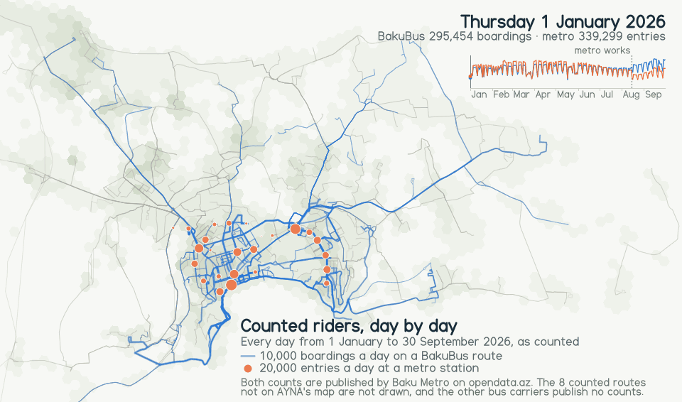
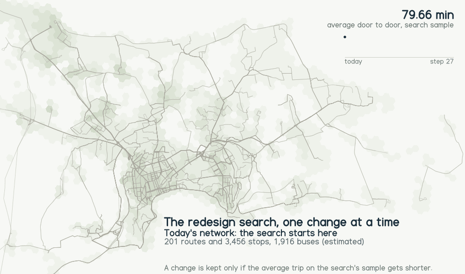
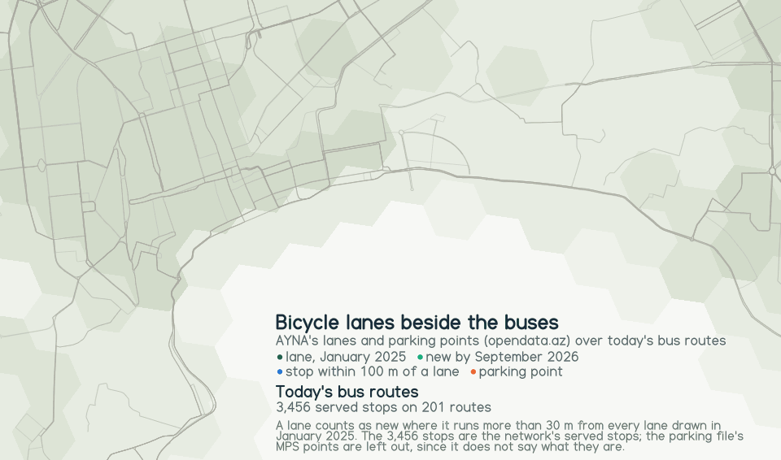
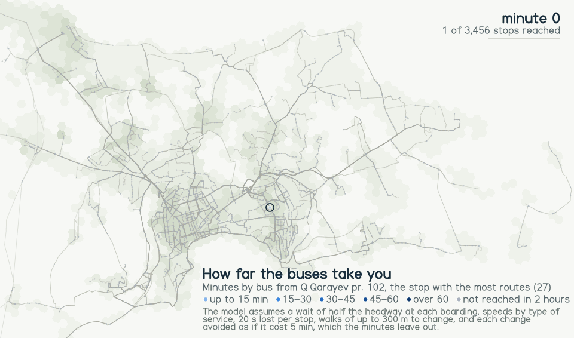

# Baku bus route efficiency

<p align="center"></p>

An hour of Baku's buses as my model runs them. AYNA publishes no timetables and no bus
positions, so this is today's GTFS feed played for an hour: every route at one frequency
all day, estimated from counted boardings on 55 BakuBus routes and from H1's published
headway (blue) and assumed from the type of service on the other 145 (orange), at speeds
set by the type of service. The other animations sit in the sections they illustrate, and
`python3 animations/build.py` draws them all from the committed data
([docs/code.md](docs/code.md#the-animations)).

Release v1.1.0 is archived on Zenodo: https://doi.org/10.5281/zenodo.23604370

I built this to measure how efficiently Baku's bus routes serve riders and what they
cost to run, using nothing but public data, and to test changes to the network before
anyone makes them. It is Python 3.11 or newer with the standard library only. Every
input is committed, every result regenerates from three commands, and the documentation
in [docs/](docs/README.md) explains the data and its defects, every setting, how each
number is computed, the redesign algorithm, every output column, the latest results,
the research behind the approach and what I would do next. The same code reads any
city's GTFS feed, so the measurements and the redesign search run wherever a timetable is
published ([below](#another-city-from-its-gtfs-feed)).

## Regenerate the results

```sh
python3 measure.py                                         # writes output/
python3 measure.py --scenario stop-balancing --min-gap 250 # also writes output/scenario.json
python3 -m unittest                                        # tests, including a regeneration check
```

Nothing here needs the internet: every input is under `data/` (see
[data/SOURCES.md](data/SOURCES.md)). To refresh the public datasets from their sources:

```sh
python3 data/fetch_external.py --refresh
```

## What the counts show

<p align="center"></p>

The counts are the only measured numbers in these animations: the daily boardings on
each BakuBus route and entries at each metro station that Bakı Metropoliteni publishes
on opendata.az, from 1 January to 30 September 2026. In the two weeks after 15 August,
when the metro works closed the line between 28 May and Nizami, weekday metro entries
were a quarter lower than in the two weeks before and BakuBus boardings a fifth higher,
almost half of the rise on the express buses M2 to M6 that AYNA runs for the works
([docs/data.md](docs/data.md#when-the-data-is-from)). The model uses the counts to set
the frequency of the 55 BakuBus routes and to check its estimated riders.

## Search for a better network

```sh
python3 redesign.py          # writes output/redesign/, about two minutes
```

<p align="center"></p>

The animation replays the 27 changes `redesign.py` keeps, one at a time, with the average
door-to-door time on the search's sample of trips.

The search keeps today's fleet and tries the changes other cities' redesigns used:
merging near-duplicate routes, dropping little-used ones, straightening detours, stop
balancing, and moving buses to where they save riders the most waiting. It uses counted
boardings wherever they exist, leaves the routes listed in `busnet.toml` alone, and
keeps a change only if the average door-to-door trip gets shorter without leaving people
with no stop within walking distance. I then check the result on a different sample of
trips than the search used. Its settings are in the `[redesign]` table of `busnet.toml`.

| File in `output/redesign/` | Contents |
|---|---|
| `changes.csv` | Every change kept, in order, and what it did to average door-to-door time |
| `routes.csv` | Each route before and after: kept, straightened, merged or dropped; buses, headway, length |
| `summary.json` | Riders, operator and network measures before and after, and the fleet that would match today's travel times |
| `impact.csv` | What the redesign is worth, with today's buses and with fewer: minutes per trip, people near a stop, buses, bus-hours, bus-km, fuel and CO₂ a day, and money once prices are set |
| `network.geojson` | The redesigned and dropped routes; GitHub draws this file as a map |
| `gtfs_today.zip`, `gtfs_redesign.zip` | Both networks as GTFS, for other transit tools |

MobilityData's canonical GTFS validator, a Java program that is not part of the
repository, finds no errors in either feed: `python3 validate_gtfs.py --jar
gtfs-validator-8.0.1-cli.jar` writes its findings to `output/gtfs_validation/`, with the
stops it finds more than 100 m from their route's line
([docs/getting-started.md](docs/getting-started.md#checking-the-gtfs-feeds)).

Today's feed is in the Mobility Database as a community feed,
[mdb-3629](https://mobilitydatabase.org/feeds/gtfs/mdb-3629), the first there for
Azerbaijan. The database downloads it from this repository every day, so
`output/redesign/gtfs_today.zip` keeps its path on `main`
([docs/outputs.md](docs/outputs.md#outputredesigngtfs_todayzip-and-gtfs_redesignzip)).

## Another city, from its GTFS feed

```sh
python3 data/fetch_city.py my_city --feed https://example.org/gtfs.zip --country XX
python3 measure.py --config cities/my_city.toml --out output/cities/my_city
python3 redesign.py --config cities/my_city.toml --out output/cities/my_city/redesign
```

Nothing in the measurements or the search is Baku's. `data/fetch_city.py` downloads a
city's GTFS feed, Kontur's population grid for its country and OpenStreetMap's
destinations in the box of its stops, and writes a settings file whose `[data]` table
names them; `measure.py` and `redesign.py` then run on that city. The feed's timetable
gives every route the frequency and speed Baku's data lacks. The reader takes the
weekday with the most bus trips and makes one stop pattern per route direction. Short
turns count towards its frequency, large branches run as routes of their own and small
ones are left out and listed, express routes are told apart by their names and their
stops, and night routes are named so the redesign leaves them alone. It then moves the
map projection to the city. Read back, the feed this repository writes for Baku
reproduces the snapshot's results to within 0.1%.

Riga is in the repository as the worked example, from Rīgas satiksme's timetable on
Latvia's open data portal (CC0): `cities/riga.toml`, its inputs in `data/cities/riga/`
and its results in `output/cities/riga/`. [docs/cities.md](docs/cities.md) sets it beside
Baku, and [docs/getting-started.md](docs/getting-started.md#another-city-from-its-gtfs-feed)
explains the settings file.

## The world pilot: 25 cities and Baku

The same measurements and search ran on 25 more cities on five continents, each read from
the GTFS feed its operator, city or a mapping project publishes, with the same settings for
all, and on Baku read from its own feed. With the same buses, the average trip gets shorter
in every city, by 2.83 minutes in the middle one (0.75 to 8.32). Kept to today's trip times
instead, the 23 networks their operators or cities publish need 1,466 fewer of their 7,410
buses, 20%, which saves 140,105 litres of fuel and 374 tonnes of CO₂ a weekday; with the
three networks mapped from OpenStreetMap it comes to 3,872 fewer buses and 379,529 litres.
All of it rests on modelled demand, since no city but Baku publishes counts the model can
use. [docs/world.md](docs/world.md) has the table, how the cities were chosen and how far to
trust it; `output/world/` has the numbers, and `python3 world.py` regenerates them.

## Check how much the results depend on the sample and the assumptions

```sh
python3 robustness.py        # writes output/robustness/, about 15 minutes
```

This scores today's network and the redesign on ten samples of trips, runs the search
again under other assumptions (transfer penalty, trip lengths, destinations, headway
estimates, walking distance, search sample, coverage guard), checks the demand model
against observed boardings as each input is added, and measures coverage at several
walking distances. [docs/results.md](docs/results.md#how-robust-the-results-are) reads
the tables.

## Test the search where the answers are known

```sh
python3 benchmark.py         # writes output/benchmark/, about three minutes
```

The transit routing literature compares methods on small benchmark networks, Mandl's
and Mumford's four, with published route sets and scores. My scoring reproduces the
published scores of Mumford (2013), Hüsselmann et al. (2024) and Jiao (2026) to the last
decimal, apart from four Mandl sets Hüsselmann scored on a slightly different demand
matrix, and the redesign's straightening, the one kind of change the benchmarks' rules allow,
improves Mumford's route sets best for passengers on both scores: on Mumford3 the
average trip falls from 31.44 to 30.87 minutes and the route time from 6,665 to 6,047.
In the 25 later sets, which reach far lower times, it finds four changes worth a few
hundredths of a minute and nothing in the newest, so the search improves a network
rather than designing one ([docs/benchmark.md](docs/benchmark.md)).

## Run your own method on Baku

```sh
python3 instances.py         # writes output/instances/, about twelve minutes
```

The test also runs the other way. `instances.py` cuts the Baku network into five
instances in the format of Mumford's files, so that methods written for her networks can
run on a real city's: four circles round the 28 May metro station with 30, 70, 111 and
125 nodes, as near as the circles come to her 30, 70, 110 and 127, and the whole network
with 680. Each comes with today's routes, which keep its rules, and their scores; on Baku3
they give an average trip of 19.79 minutes, which straightening lowers to 17.88. Only the
positions are measured: the link times come from the travel model's speeds and the trips
from its gravity model. Christine Mumford suggested the instances
([docs/instances.md](docs/instances.md)).

## Put the bicycle lanes beside the buses

```sh
python3 bicycle.py           # writes output/bicycle/, about 4 s
```

<p align="center"></p>

The animation steps through AYNA's lanes as drawn in January 2025 and in its file of
September 2026, the new ones marked, then the bus stops within 100 m of a lane and the
parking points.

AYNA publishes its bicycle lanes and bicycle parking points on opendata.az. The lanes
run for 57.1 km on 54 streets of central Baku (44.2 km in January 2025), 47.5 km of them
beside a bus route; 45 routes run at least 0.5 km along a lane, but only 170 of the
3,456 served stops are within 100 m of one, and 106 of the 185 parking points are within
100 m of a bus stop ([docs/results.md](docs/results.md#bicycle-lanes-and-parking)).

## Change an assumption

The AYNA data has no timetables, speeds or ridership by stop, so some values are
assumptions. They all live in [busnet.toml](busnet.toml) with their sources. Edit the
file, or change one value for a single run with
`python3 measure.py --set default_headway_min=10`. Real data always wins over an
assumption: add real headways to [data/headways.csv](data/headways.csv) and they replace
the estimates. `python3 measure.py --config none` runs with the built-in defaults only.

## What is where

| Path | Contents |
|---|---|
| `data/ayna.db`, `data/ayna_scraper.py` | Bus network snapshot from the AYNA map API, and the script that builds it |
| `data/external/` | Public datasets: population, ridership, metro, statistics, OpenStreetMap, Wikidata, the answers of the metro's own API, AYNA's bicycle lanes and parking points, the benchmark networks of Mumford (2013) and the route sets later studies published on them |
| `data/headways.csv` | Real headways where known |
| `data/fetch_external.py`, `data/osm_pbf.py` | Downloads the public datasets again; the reader of OpenStreetMap PBF extracts that cuts the walking network out of Geofabrik's, and another city's destinations |
| `data/cities/`, `data/fetch_city.py` | Another city's inputs (Riga's: its GTFS feed, Kontur's grid for Latvia, OpenStreetMap destinations), and the script that downloads them for any city and writes its settings file |
| `data/world_files.csv`, `data/fetch_world.py` | The world pilot's inputs and the feeds and maps its redesigns write, kept in a Hugging Face dataset rather than in git: each file with its size and SHA-256, and the script that downloads and checks them |
| `data/metro/`, `data/metro_scraper.py`, `data/build_metro.py` | The metro network (stations, train services, running times, departures), not yet used by the model; the scripts that read the metro's API and build the tables |
| `data/metro_headways.csv` | Metro train intervals the operator has published, with sources |
| `busnet.toml` | Settings: data paths and every assumption |
| `cities/` | Settings files for other cities, read from their GTFS feeds: `cities/riga.toml`, the world pilot's 24 more, and `cities/baku.toml`, Baku read from its own feed |
| `busnet/` | The package: load and repair the network or read it from a GTFS feed, headways and daily service, demand, metrics, scenarios, the redesign search and what it is worth, GTFS export |
| `measure.py` | Measures the network and writes `output/` |
| `redesign.py` | Searches for a better network and writes `output/redesign/` |
| `robustness.py` | Repeats the results under other trip samples and assumptions and writes `output/robustness/` |
| `validate_gtfs.py` | Runs MobilityData's GTFS validator on the two feeds and writes its findings to `output/gtfs_validation/` |
| `benchmark.py` | Scores the route sets published for the Mandl and Mumford benchmark networks, by Mumford (2013), Hüsselmann et al. (2024) and Jiao (2026), and runs the redesign's straightening on them; writes `output/benchmark/` |
| `instances.py` | Cuts the Baku network into five instances in the format of Mumford's benchmark networks, Baku0 to Baku3 and BakuFull, with today's routes scored; writes `output/instances/` |
| `bicycle.py` | Puts AYNA's bicycle lanes and parking points beside the bus network; writes `output/bicycle/` |
| `world.py` | Puts the world pilot's cities in one table with their totals; writes `output/world/` |
| `tests/` | Unit tests and a regression test: `python3 -m unittest` |
| `index.html`, `site/` | The page for readers: `site/build.py` writes its data (`data.js`), the checklist (`checklist.xlsx`) and, from `og.html`, the link-preview picture (`og.png`); `app.js` and `style.css` draw it |
| `animations/` | The animations on this page: `build.py` draws them as GIFs from the data, `output/` and a rerun of the redesign search, with `draw.py`, a small drawing library and GIF writer |
| `paper/` | The manuscript and its title page; `figures.py` draws the manuscript's figures from `output/` as SVG and PDF, `check.py` checks its length, highlights and citations, and `build.py` writes the submission files (Word and a preprint PDF) to `paper/submission/` |
| `output/` | Results, regenerated by the three scripts (`output/gtfs_validation/` by `validate_gtfs.py`, `output/benchmark/` by `benchmark.py`, `output/instances/` by `instances.py`, `output/bicycle/` by `bicycle.py`, `output/cities/<city>/` by `measure.py` and `redesign.py` with `cities/<city>.toml`, `output/world/` by `world.py`) |
| `LICENSE`, `CITATION.cff` | The MIT licence for the code, and how to cite the repository |

## Outputs

| File | Contents |
|---|---|
| `routes.csv` | One row per route: length, stop spacing, directness, duplication, detours, headway and where it came from, daily trips, fleet, bus-hours and fuel, people served, observed boardings |
| `corridors.csv` | Stretches where 8 or more routes share every link |
| `duplicates.csv` | Routes whose stops are mostly served by one other route |
| `detours.csv` | Detours, their extra minutes per trip and the people only they serve |
| `ridership_check.csv` | Observed against modelled boardings per BakuBus route |
| `network.json` | Network-wide results, the inputs found and the settings used |
| `scenario.json` | The same results before and after a scenario |
| `repairs.txt` | Data defects fixed automatically before measuring |
| `timetable.txt` | From a GTFS feed only: branches run as routes or left out, express routes, and speeds that fell back to the settings |
| `robustness/` | The redesign on other trip samples and under other assumptions, the model's fit as inputs are added, coverage by radius |
| `benchmark/` | The published benchmark route sets scored here beside their published scores, and what straightening does to them |
| `instances/` | Baku in the benchmark's format: the nodes, link minutes, demand and today's routes of five instances, with their rules and scores |
| `gtfs_validation/` | What MobilityData's GTFS validator says about the two feeds |
| `bicycle/` | AYNA's bicycle lanes and parking points beside the bus network: lanes by street with the routes along them, routes along lanes, stops and parking points near lanes, people within reach |

## The data on Kaggle and Hugging Face

The AYNA snapshot `data/ayna.db` is also published on Kaggle, with its five tables as
CSV and the known defects described: https://doi.org/10.34740/KAGGLE/DSV/21173689.

The world pilot's inputs, and the feeds and maps its redesigns write, 351 MB, are not in git
but in the Hugging Face dataset
[ismatsamadov/route-efficiency-cities](https://huggingface.co/datasets/ismatsamadov/route-efficiency-cities).
`python3 data/fetch_world.py` downloads them into place and checks each against its
SHA-256 in `data/world_files.csv`.

## The page for readers who will not open the code

<p align="center"></p>

The animation spreads the travel model's minutes out from the stop with the most routes,
as the page's Travel time view does from any stop.

[index.html](index.html), the **Baku Bus Atlas**, presents the published snapshot as an
interactive research page. A guided tour flies the map through nine findings. The map has
nine views: how direct each route is, detours with the shorter path along streets
buses use in the snapshot where one exists, routes with shared stops, the busiest
corridors, estimated population beyond 400 m from a stop, stop-spacing candidates, AYNA's bicycle lanes and parking points over the buses,
the reach of any stop (the stops its buses serve without a change and with
one), and the estimated travel time by bus from any stop, from the paper's own travel
model. Every route has a card, with a Compare button for the routes it overlaps; stops
can be searched by name. A coverage sensitivity explorer lets readers select 300, 400,
500, 800 or 1,000 m using the recorded results in
`output/robustness/coverage_radius.csv`; it does not change the map's 400 m layer.
Coverage is straight-line proximity using the 2023 population grid, not verified
walking access; beside each straight-line figure the explorer shows the same distance
walked along OpenStreetMap's streets and paths, which cuts the 400 m share from 66% to
45% (`output/robustness/coverage_walk.csv`). Snapshot geometry, model estimates and questions requiring field
validation are distinguished throughout. Below the map come the issues in AYNA's map data with the
routes they affect, the checklists (also as an Excel workbook), and sortable tables of
all 201 routes and of the 39 carriers that run them. The page is in English. The address bar keeps what is on screen, so a link can point at one finding:
`#route=177`, `#view=detours`, `#view=reach&stop=60` or `#view=time&stop=60` (an AYNA stop id),
`#route=190&compare=160`, or `#tour`.

```sh
python3 site/build.py        # writes site/data.js and site/checklist.xlsx, about 3 s
python3 site/build.py --og   # also draws site/og.png, the link-preview picture (needs Chrome)
```

`site/build.py` reads `output/` and the repaired network, and stops if a figure it
recomputes disagrees with `output/`, so rerun
`measure.py --scenario stop-balancing --min-gap 250` first after any change.
GitHub Pages serves the page from the root of `main` (`.nojekyll` makes it serve the
files as they are) at https://ismatsamadov.github.io/route_efficiency/. To look at it
locally, run `python3 -m http.server` in the repository and open http://localhost:8000/.

## A planner built on the same data

The repaired network also runs a free route planner for Baku, in Azerbaijani, at
[birjob.com/aletler/avtobus-marsrutu](https://www.birjob.com/aletler/avtobus-marsrutu):
it finds the way between two stops with the fewest changes of bus, or draws any line
stop by stop with its length and approximate time. It is not a timetable, since none is
published, and its data is a snapshot that is not updated automatically.

## Licensing

The code is mine and is under the MIT License ([LICENSE](LICENSE)): `busnet/`,
`measure.py`, `redesign.py`, `robustness.py`, `bicycle.py`, `world.py`, `benchmark.py`, `validate_gtfs.py`, `instances.py`, `paper/figures.py`, `paper/check.py`, `paper/build.py`, `tests/`, `data/ayna_scraper.py`,
`data/fetch_external.py`, `data/fetch_city.py`, `data/fetch_world.py`, `data/osm_pbf.py`, `data/metro_scraper.py`, `data/build_metro.py`, `busnet.toml`, `index.html`, `site/build.py`, `site/app.js`,
`site/style.css`, `site/og.html`, `animations/build.py` and `animations/draw.py`. The page loads Leaflet 1.9.4 (BSD-2-Clause) from cdnjs and draws its
base map from OpenStreetMap's tiles, credited on the map. The documentation in `docs/` is under
[CC BY 4.0](https://creativecommons.org/licenses/by/4.0/). [CITATION.cff](CITATION.cff)
says how to cite the repository: release v1.1.0 is archived on Zenodo as
[10.5281/zenodo.23604370](https://doi.org/10.5281/zenodo.23604370), and
[10.5281/zenodo.23602093](https://doi.org/10.5281/zenodo.23602093) always resolves to the
latest release.

The data keep their own terms, listed file by file in [data/SOURCES.md](data/SOURCES.md):

- `data/external/osm/`: © OpenStreetMap contributors, under the
  [Open Database License](https://opendatacommons.org/licenses/odbl/1-0/)
  (https://www.openstreetmap.org/copyright). These extracts are a derivative database
  and are shared under the same licence.
- `data/external/kontur/`: Kontur Population, CC BY.
- `data/external/opendata/`: opendata.az datasets, CC BY (Bakı Metropoliteni) or CC0
  (AYNA, State Statistical Committee).
- `data/ayna.db`: a snapshot of AYNA's public map API with no published licence,
  redistributed as a research snapshot with attribution to AYNA; the licences above do
  not extend to it ([docs/data.md](docs/data.md#the-ayna-bus-network-snapshot-dataaynadb)).
- `data/external/metro_api/`: the same for the metro's API, Bakı Metropoliteni's data.
  `data/metro/` is built from it and from OpenStreetMap, whose part (coordinates, track
  geometry, distances) is under the ODbL.
- `data/external/wikidata/`: Wikidata, CC0.
- `data/cities/riga/`: Rīgas satiksme's GTFS feed from Latvia's open data portal (CC0
  1.0), Kontur Population for Latvia (CC BY) and OpenStreetMap extracts (ODbL, ©
  OpenStreetMap contributors). `output/cities/riga/` is derived from them and carries the
  same terms.
- The world pilot's inputs, in the Hugging Face dataset `data/fetch_world.py` downloads:
  each city's GTFS feed under its publisher's terms (CC0, CC BY, ODbL, Open Government
  Licences, or CapMetro's open data licence; [data/SOURCES.md](data/SOURCES.md) gives each),
  Kontur Population (CC BY) and OpenStreetMap extracts (ODbL). Each city's results in
  `output/cities/<city>/`, and the redesigned feeds and maps in the dataset, carry its
  feed's terms.

The results in `output/` are derived from those data and carry the same terms: the
files that contain AYNA's routes and stops (the GTFS feeds, `network.geojson` and the
CSV tables) are covered by the note on `data/ayna.db`, and the maps and tables that
draw on OpenStreetMap carry its attribution. The same holds for the page's
`site/data.js`, `site/checklist.xlsx` and `site/og.png`, which carry AYNA's routes and stops
and the Kontur population grid, and for the GIFs in `animations/`, which carry the same,
Bakı Metropoliteni's counts (CC BY) and AYNA's bicycle lanes and parking points (CC0).
