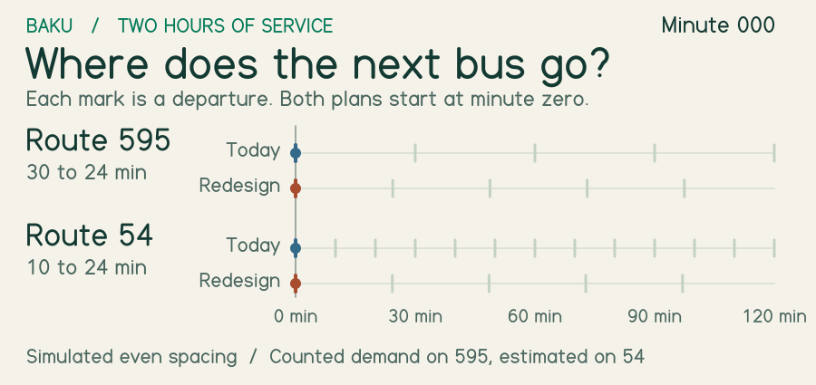
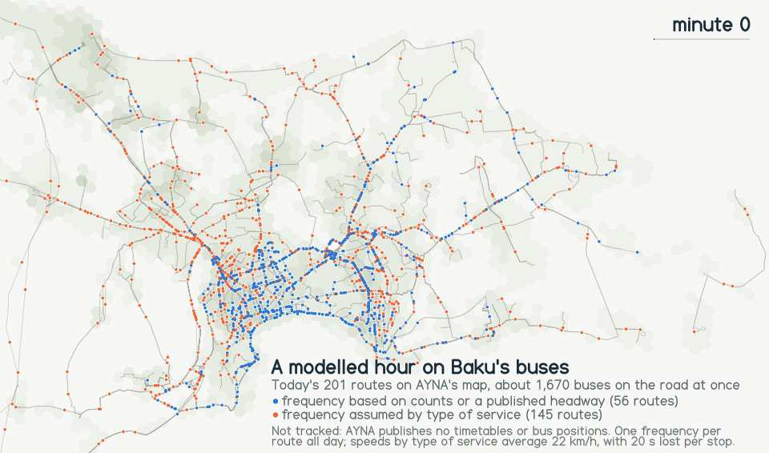
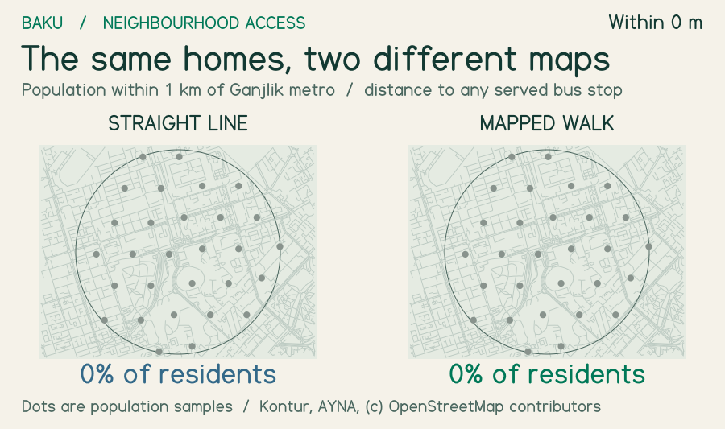
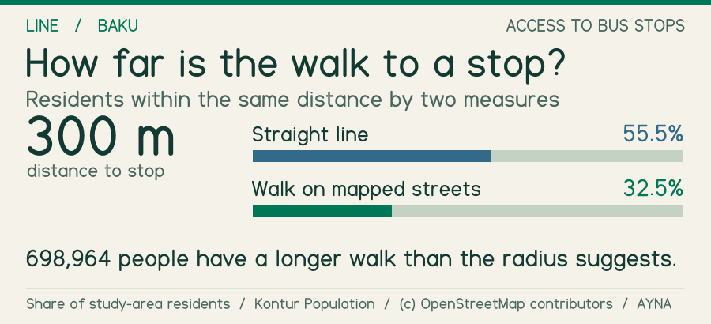

# Line | Where Baku’s next bus would make a difference

In the ten weekdays after metro works interrupted service between 28 May and Nizami in August 2026, BakuBus recorded **107,351 more boardings per weekday** than in the ten weekdays before. Five express routes, M2 to M6, accounted for 45% of that rise. A route map looks much the same from one week to the next. The passenger counts tell a different story. [Daily counts and comparison dates](docs/data.md#when-the-data-is-from)

For the next timetable, the city has to decide where an extra departure is worth most, which branches riders depend on, and how much service the fuel budget can buy. Line tests those decisions across Baku’s 201 routes.

## Same fleet next quarter. Which routes should run more often?

Start by checking **595 (Avtovağzal–Sumqayıt)** and **140E (Koroğlu–Mərdəkan)**. They carry about 2,399 and 3,133 counted boardings per September weekday, respectively. The redesign shortens their modelled departure intervals from 30 minutes to **24 and 25 minutes**. The harder decision is where the buses come from. On routes **50 and 54**, the gap grows from 10 minutes to roughly 24. Both lack passenger counts. Count their peak loads before moving a vehicle. [Route-level evidence](output/redesign/routes.csv)

Across all 27 changes, the redesigned network saves **1,268 rider-hours per 100,000 journeys** at the same daily bus-hours. The model estimates walking, waiting, transfers and riding. Rounding vehicle needs up route by route gives 2,017 buses against 2,015 today, so an operator would still need to fit the duties to the available fleet. [Travel model](docs/methodology.md) · [Before and after](output/redesign/impact.csv)

| One hour from the operator’s seat | Two hours from a rider’s stop |
|---|---|
|  |  |
| Each dot is a simulated bus. Only one route has a published interval between buses. | From Q.Qarayev pr. 102, 27 routes are available. The map shows how long it takes to reach each stop. |

## Which neighbourhoods look better served than they are?

**Around Gənclik metro, a 400-metre circle puts every resident in the population model near a bus stop. Following mapped streets and paths puts only 62% within walking distance.** That leaves about 12,700 residents on the wrong side of the estimate. The two maps below use the same population points. Watch which ones are still grey on the right when the distance reaches 400 metres.

**Avtovağzal** also falls sharply, from 87% by radius to 50% by foot, and **Qara Qarayev** from 100% to 65%. These are the three largest gaps among 27 areas, each within one kilometre of a named metro station. These are the first areas to visit on foot to look for missing paths, difficult crossings or a better stop location. [All 27 station areas](output/station_access.csv) · [Calculation](station_access.py)

| How much does walking distance matter citywide? | Could a bicycle bridge the gap? |
|---|---|
|  |  |
| At 400 metres, 66% of residents are inside a stop radius and 45% are within a mapped walk. | Just 170 of 3,456 served bus stops are within 100 metres of a mapped cycle lane. |

## Two routes share almost every stop. Do riders need both?

**114B and 114A** are candidates for a merger trial. Route 114A serves 92% of 114B’s stops. In the model, merging the two leaves everyone who had a stop within 500 metres inside that threshold. **210 and 215** overlap even more, at 93% of 210’s stops, yet their merger puts about **495 people** beyond the same threshold. Count boardings at the unique stops and trace the direct trips people would lose. Across the full redesign, the share of feasible trips requiring at least two transfers rises from 16.6% to 17.5%. [Change-by-change results](output/redesign/changes.csv) · [Transfer impacts](docs/results.md#check-these-before-acting)

## What is the fuel saving worth?

The faster service above uses slightly more fuel. A separate option runs the redesigned routes less often while matching today’s average journey time. The model then uses **26,452 fewer diesel-equivalent litres per weekday**. At AZN 1.10 per litre for 250 equivalent weekdays, that amounts to **AZN 7.27 million in gross fuel value**. At 2.67 kg CO₂ per litre, it also avoids **17,657 tonnes of tailpipe CO₂**. Actual budget savings depend on the operator’s fuel mix, purchase price and service days. [Priced results](output/baku-priced/impact.csv) · [Retail diesel benchmark](https://tariff.gov.az/post/bir-sira-mehsul-ve-xidmetler-uzre-guzestler-tetbiq-olunub-qiymetler-mueyyenlesdirilib)

[Research paper](paper/manuscript.md) · [Data and assumptions](docs/methodology.md) · [Reproduce the study](docs/getting-started.md) · [Results across 26 cities](docs/world.md) · [How the animations are made](docs/code.md#the-animations)

## Licensing

Noncommercial use requires credit. Commercial use requires the author's written permission. The code and settings use the PolyForm Noncommercial licence. The article, figures and the author’s contributions to the data and results use CC BY-NC 4.0. Third-party data retain their source terms, including © OpenStreetMap contributors (ODbL) and Kontur Population (CC BY). AYNA’s map is a research snapshot with no published licence. [Full terms and notices](LICENSE) · [Source credits](data/SOURCES.md) · [Citation](CITATION.cff)
