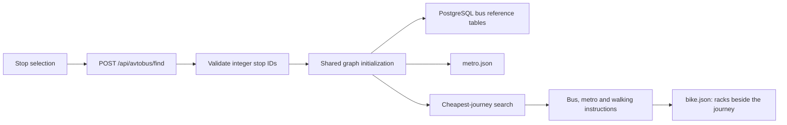

# Bus routing

The planner answers “which buses and metro trains should I take between these
stops?” from the retained AYNA reference snapshot and a snapshot of the metro
(`src/lib/busroute/metro.json`, #689). It has no schedule, vehicle positions,
traffic or waiting-time feed. Neither snapshot refreshes automatically. The map
also draws AYNA's bicycle lanes and racks, and a journey names the racks beside it
(`bike.json`, [Bicycles](#bicycles-692)); nothing routes by bicycle.



## Ranking

A destination directly connected by a walking edge of at most 400 m gets an
explicit walking-only result. Every other journey costs its estimated movement
time, walking included, plus `BOARDING_PENALTY_MIN` (15 minutes) for each
boarding, and the cheapest wins (#721). Ties go to:

1. Fewer boardings.
2. Less walking.
3. Less total estimated distance.

The 15 minutes stand for what the movement time leaves out: the wait for each
vehicle, which nothing published can estimate (no timetable or headway, #693),
and the change itself. A journey with one more boarding therefore wins only when
it is at least 15 minutes faster, and #664's promise holds where the difference
is small: one bus still beats two buses, or a bus and a train, that save less
than a quarter of an hour. The longest walk takes 5.3 minutes, less than one
boarding, so a destination within a walk is always reached on foot.

Until #721 the ranking was lexicographic, boardings first (#664): an available
one-bus journey beat every two-bus journey, however much faster the two were. It
passed over journeys such as 2147 → 2734, two buses in 67.2 minutes where a bus,
the red line and a bus take 24.8; in 20 of 196 sampled trips one more boarding
saved 20 minutes or more (times as in [Graph and data](#graph-and-data)). A finite
penalty cannot promise one bus over two for every journey length, which is why
#664 refused one; #721 gives that promise up where it costs a quarter of an hour
or more. Choosing by cost is the same as taking the fastest journey for each
number of boardings, the Pareto front of boardings and minutes, and keeping the
one with the lowest minutes plus penalty; one search finds it without listing the
front.

How much the penalty decides, on those 196 trips, counting the journeys that take
more boardings than the fewest possible:

| Penalty | Trips | Extra boardings | Minutes saved: median, least |
| --- | --- | --- | --- |
| 10 min | 75 | 69 × 1, 6 × 2 | 17.0, 10.2 |
| **15 min** | **48** | 46 × 1, 2 × 2 | 19.9, 15.0 |
| 20 min | 23 | 22 × 1, 1 × 2 | 29.3, 22.1 |

Fifteen keeps the fewest boardings in three trips of four and gives them up only
for a saving that is clear against estimates this rough. It is one constant in
`routing.ts`; where to set it is the owner's call.

A metro ride is a ride like a bus ride (#689): boarding a train, changing trains
and boarding the metro's express bus each count as one boarding and pay the same
penalty. The faster train wins among journeys with as many boardings, and a bus
and a train beat one bus when they save more than a boarding.

`src/lib/busroute/routing.ts` runs one Dijkstra search with a priority queue of
immutable labels, compared on cost, then boardings, walking and distance. A
label records the arrival stop and the last edge. Continuing a ride requires the
same `(bus, direction)` identity **and** the next consecutive route position.
Changing direction, reboarding after a walk, or boarding at a later occurrence of
a repeated stop starts another ride. Reconstruction splits instructions at those
same boarding boundaries, so ranking and displayed transfer counts agree.
Transfer count is `max(boardings - 1, 0)`. The search takes its starting labels
with their own costs; the endpoint passes one, at the chosen stop.

Walking edges cannot follow other walking edges. Because the graph includes all
nearby stop pairs, any permitted straight-line walk within the radius already
has a direct edge; chaining would only enable walks beyond the stated limit.
One walk may occur before the first ride, between rides, and after the last ride.
There is no overall walking budget across a journey with several rides.

The state includes whether a walking arrival has already boarded a bus, so an
origin walk cannot suppress an otherwise valid bus-and-walk arrival. A ride's
state is the edge it arrived by, since one edge reaches each position of a ride,
and a walk's state is a number made of its stop and that flag. Until #721 both
were strings built and hashed for every edge tried, most of a search's time.
Queue entries whose label has been replaced are skipped. The unused, incorrect Yen
alternative-path implementation and its unused optimization modes were removed;
the endpoint exposes one complete itinerary.

## Graph and data

`graph.ts` loads stops, buses and route-stop rows in parallel. Within a bus and
direction, travel order is cumulative `total_distance`, then `bus_stop_id` and
`id` as stable tie-breaks. This agrees with the line viewer. Repeated stops stay
in the graph with distinct positions so a ride cannot jump across a loop. A
missing stop breaks its adjacent legs; it is not skipped to invent a shortcut.

The snapshot stores 120A's stops twice in each direction (bus_id 160: 30 rows for
15 stops and 28 for 14, every row at `total_distance` 23.4), so travel order puts
one copy after the other. `collapseRepeatedSequence` (`sequence.ts`) keeps one copy
of a list that is an exact repeat of itself, in the graph and in the line viewer
(#685). Without it the planner rode from the terminus straight back to the first
stop as one leg and spread the line's duration over twice the legs. It changes no
other shape: a loop, a route that ends where it starts and a stop listed twice in a
row stay as they are.

Two stops of route 517, 3838 and 3839, were stored at latitude 4.05, the right
digits with the decimal point one place out, which put every journey through them
in the Indian Ocean. `prisma/migrations/2026-10-24_bus_route_517_stop_latitudes.sql`
moves them to 40.49233 and 40.49409; its header has the evidence. This finds any
other stop outside the area (0 since that file was applied on 2026-10-24). Nothing
runs it automatically:

```sql
SELECT id, name, latitude, longitude FROM bus.bus_stop_details
 WHERE latitude NOT BETWEEN 39.5 AND 41.5 OR longitude NOT BETWEEN 48.5 AND 51;
```

Since 2026-10-26, `isBakuCoordinate` in `geo.ts` applies this same generous
envelope in the graph, the stop picker/map data and the line viewer. It rejects
nonfinite coordinates as well as world-valid points outside the network's area,
including the old latitude 4.05. A rejected stop breaks its adjacent graph legs
instead of creating a shortcut through it. This protects searches and maps; it
does not repair the underlying rows or replace the read-only data audit above.

The graph uses haversine distance between stops. A bus line's stored duration is
shared out over its legs by their straight-line length (#721); a missing or
nonpositive duration falls back to 30 minutes for the whole line. AYNA's
duration is its route length at one speed: 1.66 minutes a kilometre on the median
line and never above 1.67, where the route length covers both directions (its
median ratio to the two recorded lines' lengths is 0.99). Spread over one
direction, as here, that is about 18 km/h along the road and 16 km/h in a straight
line, a usual pace for a city bus with its stops.

Until #721 the duration went to the legs in equal shares, so a leg's speed
depended on how far apart its stops were: 2.2 km/h at the 1st percentile of the
11,355 legs, 72.6 at the 99th, and 147 km/h for the 6.5 km leg of 553 in 2.65
minutes; 497 legs were slower than walking. The search rode buses for those
artifacts. #721's journey took 525 for 5.6 km in 10.3 minutes (33 km/h, twice its
line's pace) to catch 503 at Xırdalan rather than where it starts, at Avtovağzal.
Shared by length, each leg keeps its line's pace: 10.6 to 21.9 km/h for 98% of
legs and 32.5 at most (line 517). The model still knows no dwell time, traffic or
faster highway stretches, and a leg whose road loops far beyond the straight line
between its stops (40 legs over 1 km, [Road shapes](#road-shapes)) is still
timed by the straight line. Neither figure is road geometry or a live estimate.
`totalTime` contains movement only; the boarding penalty decides the choice and
is not added to the time shown.
`totalStops` counts stop and metro-station visits, merging an adjacent shared
transfer stop once while preserving repeated visits around loops and distinct
walking-transfer endpoints.

`walking.ts` builds bidirectional connections of at most `WALK_RADIUS_KM` from
the same coordinates. That limit is 400 m, about five minutes on foot and the
distance a bus stop is usually taken to serve; it was 300 m until #721, which left
Azərbaycan Hava Yolları QSC (stop 1343) without the 28 May hub (stop 105) 355 m
away, so its trip to Sumqayıt took three buses where two go through Avtovağzal. A
spatial grid covers nearby Baku stops without an all-pairs scan; its cells, and
the boxes the metro searches around a station's exits, are sized from the limit
for the narrowest degree of longitude in the network's area. Connections do not
depend on input order or bus membership; even two stops served by the same line
can need a walk because their directions differ. The
graph no longer reads legacy `bus_walking_edges`, whose generation omitted useful
pairs. That table kept its rows until the owner had it dropped on 2026-10-25 (#688,
`prisma/migrations/2026-10-25_drop_retired_data.sql`); every other reference table
remains, and no migration or production write was needed to repair the graph.

`getGraph()` caches the initialization **promise**, returning only a completed
graph to concurrent callers. A failure clears that promise so the next request
can retry with a fresh graph. The API catches failures and returns a localized
error rather than letting a database exception escape.

## Road shapes

`shape.ts` draws a ride along AYNA's recorded route line (`bus_route_coordinates`)
instead of straight lines between its stops (#685). The lines cannot be drawn as
stored: three directions are pieces joined by straight jumps of 9 to 20 km (557, 550
and 555, direction 1), two lie outside Baku (531 direction 1 has latitude equal to
longitude, 521 direction 2 has the two swapped), some are filed under the other
direction or stored backwards, and four directions have none.

So the graph reads every line once per process (`queryRouteShapes`, about 109,000
points) and places each ride's stops on a line in travel order: a dynamic program
that never moves backwards along the line and minimises each stop's squared
distance from it, a stop more than 300 m away staying unmatched. The ride's own line
and the bus's other direction are each tried as stored and reversed. The fit with
the most legs on the road wins. On a tie the ride keeps its own line unless another
fits clearly closer, its stops' median offset under 70% of the own line's: the rule
the open-data study of the network used to refile misfiled lines. Two lines of one
bus can both reach every stop and take other streets (553's are 18.6 and 27.9 km),
so a slightly closer fit is not enough. A small cost per kilometre between the first
and last stop places a terminus past a loop with no stops on it rather than before
it. A leg gets the road only when both its stops are matched, it is not two stops
apart meeting at one point of the line, and no straight stretch on the way is longer
than 5 km; every other leg stays straight, and so does a walk.

Bus edges carry their leg's road, and a journey's ride joins them
(`RouteSegment.path`). The line viewer matches its stops to the bus's lines the same
way, so it no longer draws a broken line as stored; its coordinates are empty when
nothing fits, and the map then joins the stops. Distances and times do not change:
they still come from straight lines between stops, as the page says. If the lines
fail to load, the graph builds without them and every ride is drawn straight until
the process restarts: the graph is built once, and only a console error says so.
The line viewer also catches a failure reading its optional road geometry: it
returns the ordered stops with empty coordinates, allowing the map to join those
stops. A geometry-table failure therefore does not hide an otherwise usable line.

Measured on a copy of the production tables on 2026-10-24: 11,230 of 11,355 legs get
the road, and the graph builds in about 1.1 s with the lines. Of 300 random trips,
723 of 731 rides were drawn along the road, each starting and ending within 300 m of
its stops and none with a jump; line 521's second direction now stays inside Baku.
Forty legs over 1 km are more than four times the straight line between their stops.
They follow the recorded line around loops, which the open-data study of the network
lists as detours on many of those routes: 112 direction 2 has 4.5 km of road between
stops 40 m apart. 553 direction 1's line, the one the study files under it, runs a
9 km loop with no stops between its first two stops; the recorded line shows it, and
nothing here can confirm the bus drives it.

## Metro (#689)

The metro joins the graph from `src/lib/busroute/metro.json`, which
`scripts/bus/build_metro_json.py` writes from the metro tables of the open-data
study of the bus network (github.com/ismatsamadov/route_efficiency, `data/metro/`,
built there by its `data/build_metro.py`). The study read the operator's own API
on 25 October 2026: its journey planner timed every train service both ways. It
took the stations and the track from OpenStreetMap (data of 24 October) and the
operator's 98 exits from opendata.az. `metro.json` records the commit it came
from and carries 27 stations with their exits, and 14 rides with 48 legs, each
leg with its running time, its track distance and its stretch of track. The
OpenStreetMap part is under the ODbL, credited on the map and on the page; the
operator's part is a snapshot like AYNA's.

**What a ride is.** The operator's planner starts a new leg where a passenger
changes, and the script keeps a change only where the planner makes it both ways:
a train that runs through a station one way runs back through it. On the
25 October snapshot that gives:

- red line: İçərişəhər – Əhmədli, and a shuttle on to Həzi Aslanov while that
  station's turnback siding is repaired (the operator said on 23 October that the
  shuttle ends "in the coming days"); Nəriman Nərimanov – Bakmil;
- green line: Dərnəgül – Nizami, then the express bus to 28 May, since no trains
  have run between Nizami and 28 May since 15 August 2026 (works; the buses run
  06:00–00:00); Cəfər Cabbarlı – Şah İsmayıl Xətai;
- purple line: Xocəsən – 8 Noyabr. The planner waits at Avtovağzal on the way to
  Xocəsən only, so that is not a change and the ride runs through.

A ride's times are running times. The planner's waits are left out, as every wait
is. Three of the operator's figures are kept as given though they look wrong. Two
are the first leg out of a terminus: 6.5 minutes from Şah İsmayıl Xətai to Cəfər
Cabbarlı against 3.0 the other way over the same 2.2 km, and 5.0 minutes from Həzi
Aslanov to Əhmədli against 2.5 the other way over the same 1.4 km, both perhaps
counting time standing at the terminus. The third is the express bus's numbers, M1
and M2 in its structured answer but "M2 or M3" in its own instruction text; the bus
is shown as M1/M2.

**In the graph** (`metro.ts`, added by `TransitGraph.addMetro`). Stations are nodes
numbered from `METRO_STATION_ID_BASE` (1,000,000) in their order in `metro.json`;
AYNA's stop ids end at 3,841, and the graph leaves the metro out rather than let a
stop id into that range. The stop picker does not offer stations, so journeys still
start and end at bus stops. A ride's legs are `metro` edges with the ride's
identity and consecutive positions, which the search continues exactly like a bus
direction. A stop within a walk (400 m) of a station's nearest exit gets a walk to
and from the station, measured to that exit and drawn by it (stop, exit, station);
the minutes inside the station, escalators and passages, are not counted. The two
pairs of stations within a walk of each other are the interchanges, 28 May and
Cəfər Cabbarlı (35 m) and Memar Əcəmi and Memar Əcəmi-2 (129 m), and are joined by
walks; the next closest pair is 812 m apart. A walk still cannot follow a walk, so
a walk to one station cannot go on to the next on foot. Bakmil's only exit has no
bus stop within a walk (the nearest is 0.7 km away), so no journey uses Bakmil.
If the metro cannot be built the graph is
built without it and the console says so, as with the road shapes.

**Shown.** A segment has a `mode` (`bus`, `metro` or `walk`); a metro train or the
metro's express bus also has its `line` (the operator's name and colour), bus id
-2 (`METRO_RIDE_BUS_ID`) and, as `busNumber`, the line's name or the bus numbers.
Its `headsign` is the ride's terminus and its `direction` is null. The step list
names a train "Metro · Qırmızı xətt" with its stations and terminus, a station at
either end of a walk as "<name> metrosu", and the express bus as "Ekspres avtobus
M1/M2" with a note that no trains run there. The map draws a train in its line's
colour on a dark casing and each station as an "M" in that colour. Buses keep their
colours (`segmentColors.ts`, shared by the list and the map).

**Measured** on 2026-10-25 against the AYNA snapshot in route_efficiency's
`data/ayna.db` (the same 3,456 stops and 208 buses as production), with a local
harness that is not committed. The graph builds in 0.75 s with the metro, and 26
of the 27 stations reach a stop. Of 1,500 random trips, 204 use the metro: 9 need
fewer boardings than by bus alone, and 195 keep their boardings and are 9.1 minutes
faster on average. None got slower or needed more boardings, and every journey
passed checks for gaps between segments, walks over 300 m, two walks in a row and
the transfer count. Neftçilər m/st → 28 May m/st now takes the red line, 19.9
minutes against 40.6 by bus 49. Şah İsmayıl Xətai → Ulduz takes the branch line,
the interchange and the red line, 17.2 minutes against 54.4 by two buses.
Həzi Aslanov m/st → Sahil m/st stays on bus 20, because the metro would need the
change at Əhmədli. What #664's rule costs: in 320 of 590 random trips a journey
with one more boarding would be at least 10 minutes faster (22 on average, waits
not counted), but 262 of those exist by bus alone, so this is the rule's trade-off
and not the metro's; 135 of them use the metro. These figures predate #721, which
replaced that rule and the equal shares of a line's time ([Ranking](#ranking)).

**Refreshing.** In route_efficiency, `python3 data/metro_scraper.py` and
`python3 data/build_metro.py`; then here
`python3 scripts/bus/build_metro_json.py <path to route_efficiency>`. If the
services changed, `metro.test.ts` fails on its list of rides: update that list and
this section together, since they are what riders are told. The file is
re-included in `.gitignore`, whose `*.json` line would otherwise keep it out of git
and so off the box, and `metro.test.ts` fails if it stops being.

## Bicycles (#692)

The map draws Baku's bicycle lanes and bicycle racks, and a found journey names the
racks nearest its first boarding and its last alighting. Both come from AYNA's open data
on opendata.az, under CC0 (Creative Commons CCZero): "Velosiped zolaqlarının coğrafi
koordinatları" (the lanes, its layer "Mövcud zolaqlar", file of 24 September 2026) and
"Velosiped parkinq məntəqələrinin coğrafi koordinatları" (the racks, its layer
"velosiped məntəqələri yeni", MPV-1-2 to MPV-185-2, file of 4 May 2026; the portal's
24 September date for it is an edit of the description, and the layer inside is named
after an older file, "velosiped məntəqələri.11 sentyabr.kmz"). The issue pointed at
samirmehd1yev/TransportTech, a hackathon repository whose two KMZ files are byte for byte
the portal's, so `src/lib/busroute/bike.json` is built from the portal's files.
`scripts/bus/build_bike_json.py` writes it and records both files' SHA-256.

**What the data is.** 60 lane segments on 54 streets, 57.1 km in all (the file has a
61st record, for 8 Noyabr pr., with no points), and 185 racks, four of them on the
Absheron coast north of the city (MPV-144-2 to MPV-147-2). The parking dataset says what
it covers: only where the racks are, and not how much they are used, by how many people,
or any other operating figure. They are places to leave a bicycle; nothing in the data is
a bicycle to hire. The same file holds 649 points named MPS-* under "My Places", which
the script leaves out on purpose: the file's name (mpv-v-mps) pairs them with the racks,
and the dataset's Russian title names bicycles and scooters, so they read as scooter
parking; only the MPV layer is named for bicycles.

**Why nothing routes by bicycle.** A cycle leg needs a bicycle where the journey starts,
which the data cannot say, and a road network for cycling, which the planner does not
have. It would also undo the ranking: a leg on a bicycle pays no boarding, so riding all
the way would win most trips. The planner keeps its stop-to-stop journeys and adds what
the data supports: where to leave the bicycle.

**Beside a journey** (`journeyBikeParking` in `bike.ts`, called by
`POST /api/avtobus/find`). The rack nearest the first ride's first stop or station, and
the one nearest the last ride's last, each within the planner's walk (400 m). A walk before
the first ride or after the last is not counted, since the bicycle takes its place, and a
journey on foot gets none. The response carries them as `bikeParking`: `boarding` and
`alighting`, either of them null, or null altogether. If they cannot be worked out, the
journey is sent without them and the console says why. The step list names each rack
with its stop and its straight-line distance, and the map marks it with a green "P" at
any zoom.

**On the map** (`BusMap.tsx`). The lanes are a dotted green line, apart from every route
line (solid) and the walk (dashed grey). The racks are green dots from zoom 14, where
they stop crowding each other: the median gap between a rack and its nearest neighbour is
260 m. A switch in the map's corner, "Velosiped zolaqları", turns both off. Neither takes
a tap: a lane is not interactive, and a rack shows its name without the tap going on to
choose the nearest stop. `bike.json` travels in the map's chunk (7.6 KB gzipped), so it
loads with the map and not with the page.

**Measured** on 2026-10-29 against route_efficiency's `data/ayna.db` (the same 3,456
served stops as production): 453 stops have a rack within 300 m and 170 within 100 m.
16 of the 27 metro stations have one within 300 m of the station's point, 15 of them
within 120 m, and 178 of the 185 racks are within 300 m of a stop.

**Refreshing.** AYNA says it updates the parking dataset every six months. Download the two
files from their dataset pages (the script's header has the addresses), then
`python3 scripts/bus/build_bike_json.py movcud-zolaqlar-velo.kmz mpv-v-mps.-son.kmz`.
If what they hold changed, `bike.test.ts` fails on its counts: update them and this
section together. The file is re-included in `.gitignore`, as metro.json is, and
`bike.test.ts` fails if it stops being.

## API and UI

`POST /api/avtobus/find` accepts positive PostgreSQL integer IDs. Invalid JSON,
invalid IDs and identical stops return 400 before loading the graph. Unknown
stops or an unreachable destination return 404; initialization failures return
500 with a retryable error message. Error bodies keep the string shape consumed
by the client. A successful response includes origin/destination metadata, a
single `RouteResult` and the racks beside it, `bikeParking` (#692). Every segment has its `mode`; bus segments include their
direction and terminal name, and metro segments their line and terminus.

The browser automatically searches when the selected stops change. Each request
has a generation number; changing stops, swapping them, choosing a location or
switching mode invalidates an older response. A delayed itinerary cannot overwrite
the current selection. Results show boarding/alighting stops, walking endpoints,
terminal direction and movement-time limitations. Walking-only journeys are
labeled “Piyada,” rather than “0 avtobus.”

Stop and bus searches fold Azerbaijani letters and Latin keyboard equivalents
(including dotted İ), support words in any order, and rank exact names/codes
before prefix and partial matches. Empty stop searches suggest transport hubs.
The picker uses a labeled combobox and listbox; arrow keys select an option,
Enter chooses it, and Escape or Tab closes the suggestions. Stop-list and
bus-list failures have retry controls rather than looking like an empty network.

GPS and empty-map taps choose a stop only within 600 m. That selection radius is
separate from the routing graph's 400 m walking-transfer limit. The GPS selection
shows the approximate distance to its stop and says that this access walk is not
included in the itinerary's movement time. A location callback is invalidated by
later selections or a mode change, so delayed GPS cannot replace a newer origin.

`GET /api/avtobus/line` takes `busId` as a positive PostgreSQL integer written in
digits, and `direction` as 1 or 2 (no direction means 1); anything else is a 400
before any query. `parseInt` used to read “1junk” and “1.5” as 1 and pass ids past
int4 to Prisma, which threw. The stop and bus lists show an error when their
request fails; a 500 body is JSON too, and used to read as an empty list. On a phone,
the map loads when first opened and remains mounted when its tab is hidden. Desktop
loads it immediately. A fit made while hidden once landed at maximum zoom on the
journey's middle; whenever the map goes from 0×0 to a real size it fits again, and
an ordinary window resize keeps the view (#685). New phone results scroll into view,
respecting reduced-motion preferences. The line summary uses the returned stop order
for its endpoints, including the return direction.

## Automated verification

Tests cover the boarding penalty below, at and above its threshold, tie-breaks,
origin and interchange walks, the walking limit, directions, loops, unreachable
stops, the length-shared leg times, initialization concurrency/retry and API
input/error handling. An independent round-by-boardings oracle checks 900 trips
over generated small networks, choosing the round with the lowest minutes plus
penalties. The spatial grid is checked against exhaustive haversine pairs, at
Baku's latitude and at the network's northern edge.

`routingOracle.test.ts` adds 900 generated trips checked against a separate
boarding-round cost oracle. It expands complete contiguous ride stretches in each
round and allows one walk between rounds, rather than reproducing the production
edge/state Dijkstra, and then chooses among the rounds by cost. Its mixed bus/metro
networks include loops, origin walks, interchanges and destination walks. It checks
every ranking objective, transfer counts, segment continuity and the absence of
consecutive walking segments. Both oracles assert that more than ten of their trips
take more boardings than the fewest, so the penalty is exercised and not only the
boarding count.

## Verification for #721 (2026-11-11)

The owner's request was `{fromStopId: 1343, toStopId: 3642}`: Azərbaycan Hava
Yolları QSC in central Baku to Nizami Gəncəvi adına uşaq kitabxanası in Sumqayıt,
24.8 km apart. Only 503, in its second direction, stops within 400 m of the
library, so every journey ends on it; the question is where to board it.

- **Before:** walk 261 m, 61 for 19 stops, 525 for 7 stops to Xırdalan
  Qəbirstanlığı, then 503 for 28 stops: three boardings, 94.6 minutes as then
  estimated. The 300 m walk ruled out the 28 May hub 355 m away, and equal time
  shares made 525 twice as fast as its line, so the journey caught 503 at Xırdalan.
- **Times shared by length alone:** 61, a walk to 8 Noyabr, the purple line to
  Avtovağzal, a walk, then 503 from Avtovağzal m/st: three boardings, 104.4 minutes.
- **After (400 m walks as well):** walk 379 m to 28 May m/st (stop 1711), bus 2 for
  16 stops to Biləcəri dairəsi, walk 248 m to Avtovağzal m/st, then 503 for 35
  stops: two boardings, 112.8 minutes. Timed the same way, the old journey takes
  109.7 minutes, so the new one costs 142.8 against its 154.7. The cost rule does
  not change this answer; the fewest boardings are also the cheapest here.

No defect was found in the search itself. On 196 routable random pairs the old
search returned exactly the fewest-boardings journey that an independent search
over boardings and minutes found: its state keys, ride continuation, stale-entry
skipping and early return are sound. The wrong journey came from the model: the
walk limit, the equal shares and the rule.

**Measured on 200 random pairs** (seed 721; 196 routable before and after), each
change on its own with the others as before:

- times shared by length: 116 answers change, none in its number of boardings;
- 400 m walks: 44 change, 20 of them to one boarding fewer;
- the cost rule: 48 change, all to more boardings (46 by one, 2 by two), each
  saving at least 15 minutes and 19.9 at the median.

All together 147 of 196 answers change. Timing old and new journeys alike, by
length: 13 need fewer boardings (12 one fewer, one two fewer; 234 m more walking at
the median), 93 keep their count and save 3.3 minutes at the median (6.3 on
average), and 41 add boardings and save 26.3 minutes at the median (31.2 on
average, never under 15). Boardings over the 196 trips go from 522 to 551 and
average walking from 266 to 283 m. The time shown rises by 3.3 minutes at the
median: equal shares had let the search find legs faster than their line.

**Search cost**, old and new in one run on those pairs (the old search on the old
model): 7.0 ms at the median instead of 13.8, and 13.4 ms at the 95th percentile
instead of 29.3; another run gave 7.9 and 15.1 against 13.8 and 31.4. Labels
settled went from 6,240 to 7,217 at the median and from 14,102 to 14,373 at the
95th percentile, with 16,590 walking edges instead of 10,264; 1343 → 3642 settles
13,537 instead of 12,657. The time went to string keys (see [Ranking](#ranking));
keyed by edge, the new search returned the same journey as with strings for all
200 pairs.

**How.** A scratch PostgreSQL was loaded from route_efficiency's `data/ayna.db`
(the same 3,456 served stops, 208 buses and 11,786 stop rows as production, stop
order from its `seq`) and read by the real `graph.ts` through Prisma. Running the
old search on the new graph, with equal shares restored and walks over 300 m left
out, reproduced all 200 old answers. The harness and the database stay outside the
repository; nothing was read from or written to production.

## Verification on 2026-10-26

The targeted planner, bus-routing and API suites passed 118 tests in 14 files. Regression
tests cover the historical out-of-area latitude, consistent filtering for the
picker and line map, and usable line stops when optional geometry cannot load.

A separate harness built the real graph, metro and shapes against a read-only
local AYNA snapshot (3,456 served stops, 208 buses), mocking only the database
reads. Of 600 sampled pairs, 594 had a route and six were unreachable; 68 routes
used metro and the largest transfer count was four. Every boarding count agreed
with an independent line-round oracle. Endpoint continuity, walking limits,
movement-time/distance sums and geometry jump checks passed; 1,472 of 1,488 rides
had a matched shape. This was local snapshot verification, without production
writes. The harness and exported snapshot remain outside the repository. Browser
launch and local PostgreSQL initialization were blocked by the sandbox, so this
run does not establish browser behavior for the redesigned interface. TypeScript,
Next lint and architecture checks pass. The production compiler also passes using
actual Archivo files downloaded through curl and supplied locally to Next's font
loader, since Node cannot resolve Google Fonts here. Full prerendering stops on
job pages that require the unavailable database. The full gate cannot pass in this
environment: PostgreSQL/network-binding integration suites cannot run. Correcting
PATH during deployment preflight made Python lint and all 414 Python tests pass.
No gate checks were bypassed to publish or deploy these changes.

Three separate temporary React server-rendering tests verify the actual page and
journey component: one H1, labeled comboboxes, unique element IDs, canonical/OG URL,
all three JSON-LD blocks, agreement between visible FAQ and schema answers, and
boarding/alighting instructions, intermediate stops and walking-only output.
These checks establish HTML/SEO output, not browser layout or interactions.

## Historical verification for #664

A read-only production snapshot on 2026-10-17 contained 3,456 stops, 208 buses and
402 directions. A local comparison with the previous implementation checked 200
trips: 134 used fewer boardings; all 100 sampled direct journeys retained at most
one boarding. Row-ID ordering currently agreed with cumulative-distance order in
all 402 directions, so the ordering change is preventative. The grid produced
10,260 walking edges versus 10,256 legacy rows. Snapshot files remain outside the
repository and the checks wrote no production data.

The production build and all eight sitemap/content guards passed. Browser
verification used that local production build with an explicit read-only tunnel
DSN. Desktop (1440 px) and phone (390 px) checks covered direct, walking and
three-bus journeys, unreachable destinations, API failure/retry, discarding a
delayed response, line viewing/direction changes and endpoint swapping. The
Neftçilər → 28 May browser journey used one bus, with a short initial walk.
No browser exceptions or horizontal overflow occurred. Other browser mutations
were intercepted; no email was sent and no production account was changed.

For a manual browser check, select a start and destination, verify the returned
bus count and directions, then swap endpoints. Change the destination while a
request is pending and ensure only the new selection appears. Check a short
walking trip, an unreachable pair and an API failure on phone and desktop. The
API-to-database check must use an explicit read-only tunnel DSN, never the retired
Neon value in `.env.local`.
