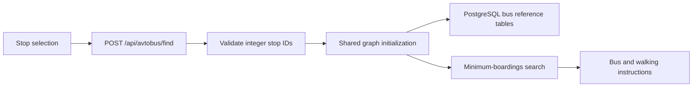

# Bus routing

The planner answers “which buses should I take between these stops?” from the
retained AYNA reference snapshot. It has no schedule, vehicle positions, traffic
or waiting-time feed. The snapshot does not refresh automatically.

## Ranking

A destination directly connected by a walking edge of at most 300 m gets an
explicit walking-only result. Other trips are ranked lexicographically:

1. Number of boardings.
2. Estimated movement time, including walking.
3. Walking distance.
4. Total estimated distance.

This implements #664's requested preference: an available one-bus itinerary wins
over every two-bus itinerary, even when the latter has a shorter estimated time.
It does not promise the fastest journey. Increasing a finite transfer penalty
would not enforce this preference for arbitrary journey lengths.

`src/lib/busroute/routing.ts` runs one Dijkstra search with a priority queue of
immutable labels. A label records the arrival stop and the last edge. Continuing
a ride requires the same `(bus, direction)` identity **and** the next consecutive
route position. Changing direction, reboarding after a walk, or boarding at a
later occurrence of a repeated stop starts another ride. Reconstruction splits
instructions at those same boarding boundaries, so ranking and displayed
transfer counts agree. Transfer count is `max(boardings - 1, 0)`.

Walking edges cannot follow other walking edges. Because the graph includes all
nearby stop pairs, any permitted straight-line walk within the radius already
has a direct edge; chaining would only enable walks beyond the stated limit.
One walk may occur before the first ride, between rides, and after the last ride.
There is no overall walking budget across a journey with several rides.

The state includes whether a walking arrival has already boarded a bus, so an
origin walk cannot suppress an otherwise valid bus-and-walk arrival. Queue
entries whose label has been replaced are skipped. The unused, incorrect Yen
alternative-path implementation and its unused optimization modes were removed;
the endpoint exposes one complete itinerary.

## Graph and data

`graph.ts` loads stops, buses and route-stop rows in parallel. Within a bus and
direction, travel order is cumulative `total_distance`, then `bus_stop_id` and
`id` as stable tie-breaks. This agrees with the line viewer. Repeated stops stay
in the graph with distinct positions so a ride cannot jump across a loop. A
missing stop breaks its adjacent legs; it is not skipped to invent a shortcut.

The graph uses haversine distance between stops. A bus line's stored duration is
spread evenly over its legs; missing/nonpositive duration falls back to 30
minutes for the whole line. Neither figure is road geometry or a live estimate.
`totalTime` contains movement only, with no invented wait or transfer penalty.
`totalStops` counts bus-stop visits, merging an adjacent shared transfer stop
once while preserving repeated visits around loops and distinct walking-transfer
endpoints.

`walking.ts` builds bidirectional connections of at most `WALK_RADIUS_KM` from
the same coordinates. A spatial grid covers nearby Baku stops without an all-pairs
scan. Connections do not depend on input order or bus membership; even two stops
served by the same line can need a walk because their directions differ. The
graph no longer reads legacy `bus_walking_edges`, whose generation omitted useful
pairs. That table and every reference row remain intact; no migration or production
write is required to repair the graph.

`getGraph()` caches the initialization **promise**, returning only a completed
graph to concurrent callers. A failure clears that promise so the next request
can retry with a fresh graph. The API catches failures and returns a localized
error rather than letting a database exception escape.

## API and UI

`POST /api/avtobus/find` accepts positive PostgreSQL integer IDs. Invalid JSON,
invalid IDs and identical stops return 400 before loading the graph. Unknown
stops or an unreachable destination return 404; initialization failures return
500 with a retryable error message. Error bodies keep the string shape consumed
by the client. A successful response includes origin/destination metadata and a
single `RouteResult`; bus segments include their direction and terminal name.

The browser automatically searches when the selected stops change. Each request
has a generation number; changing stops, swapping them, choosing a location or
switching mode invalidates an older response. A delayed itinerary cannot overwrite
the current selection. Results show boarding/alighting stops, walking endpoints,
terminal direction and movement-time limitations. Walking-only journeys are
labeled “Piyada,” rather than “0 avtobus.”

## Verification for #664

Tests cover direct-bus preference, minimum transfers, tie-breaks, origin and
interchange walks, the walking limit, directions, loops, unreachable stops,
initialization concurrency/retry and API input/error handling. An independent
round-by-boardings oracle checks 900 trips over generated small networks. The
spatial grid is checked against exhaustive haversine pairs.

A read-only production snapshot on 2026-10-17 contained 3,456 stops, 208 buses and
402 directions. A local comparison with the previous implementation checked 200
trips: 134 used fewer boardings; all 100 sampled direct journeys retained at most
one boarding. Row-ID ordering currently agreed with cumulative-distance order in
all 402 directions, so the ordering change is preventative. The grid produced
10,260 walking edges versus 10,256 legacy rows. Snapshot files remain outside the
repository and the checks wrote no production data.

The production build and all eight sitemap/content guards passed. Browser
verification used that local production build with an explicit read-only tunnel
DSN. Desktop (1440 px) and phone (390 px) checks covered direct, walking and
three-bus journeys, unreachable destinations, API failure/retry, discarding a
delayed response, line viewing/direction changes and endpoint swapping. The
Neftçilər → 28 May browser journey used one bus, with a short initial walk.
No browser exceptions or horizontal overflow occurred. Other browser mutations
were intercepted; no email was sent and no production account was changed.

For a manual browser check, select a start and destination, verify the returned
bus count and directions, then swap endpoints. Change the destination while a
request is pending and ensure only the new selection appears. Check a short
walking trip, an unreachable pair and an API failure on phone and desktop. The
API-to-database check must use an explicit read-only tunnel DSN, never the retired
Neon value in `.env.local`.
