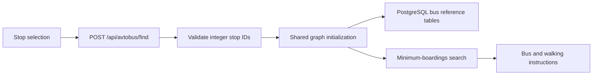

# Bus routing

The planner answers “which buses should I take between these stops?” from the
retained AYNA reference snapshot. It has no schedule, vehicle positions, traffic
or waiting-time feed. The snapshot does not refresh automatically.



## Ranking

A destination directly connected by a walking edge of at most 300 m gets an
explicit walking-only result. Other trips are ranked lexicographically:

1. Number of boardings.
2. Estimated movement time, including walking.
3. Walking distance.
4. Total estimated distance.

This implements #664's requested preference: an available one-bus itinerary wins
over every two-bus itinerary, even when the latter has a shorter estimated time.
It does not promise the fastest journey. Increasing a finite transfer penalty
would not enforce this preference for arbitrary journey lengths.

`src/lib/busroute/routing.ts` runs one Dijkstra search with a priority queue of
immutable labels. A label records the arrival stop and the last edge. Continuing
a ride requires the same `(bus, direction)` identity **and** the next consecutive
route position. Changing direction, reboarding after a walk, or boarding at a
later occurrence of a repeated stop starts another ride. Reconstruction splits
instructions at those same boarding boundaries, so ranking and displayed
transfer counts agree. Transfer count is `max(boardings - 1, 0)`.

Walking edges cannot follow other walking edges. Because the graph includes all
nearby stop pairs, any permitted straight-line walk within the radius already
has a direct edge; chaining would only enable walks beyond the stated limit.
One walk may occur before the first ride, between rides, and after the last ride.
There is no overall walking budget across a journey with several rides.

The state includes whether a walking arrival has already boarded a bus, so an
origin walk cannot suppress an otherwise valid bus-and-walk arrival. Queue
entries whose label has been replaced are skipped. The unused, incorrect Yen
alternative-path implementation and its unused optimization modes were removed;
the endpoint exposes one complete itinerary.

## Graph and data

`graph.ts` loads stops, buses and route-stop rows in parallel. Within a bus and
direction, travel order is cumulative `total_distance`, then `bus_stop_id` and
`id` as stable tie-breaks. This agrees with the line viewer. Repeated stops stay
in the graph with distinct positions so a ride cannot jump across a loop. A
missing stop breaks its adjacent legs; it is not skipped to invent a shortcut.

The snapshot stores 120A's stops twice in each direction (bus_id 160: 30 rows for
15 stops and 28 for 14, every row at `total_distance` 23.4), so travel order puts
one copy after the other. `collapseRepeatedSequence` (`sequence.ts`) keeps one copy
of a list that is an exact repeat of itself, in the graph and in the line viewer
(#685). Without it the planner rode from the terminus straight back to the first
stop as one leg and spread the line's duration over twice the legs. It changes no
other shape: a loop, a route that ends where it starts and a stop listed twice in a
row stay as they are.

Two stops of route 517, 3838 and 3839, were stored at latitude 4.05, the right
digits with the decimal point one place out, which put every journey through them
in the Indian Ocean. `prisma/migrations/2026-10-24_bus_route_517_stop_latitudes.sql`
moves them to 40.49233 and 40.49409; its header has the evidence. This finds any
other stop outside the area (0 since that file was applied on 2026-10-24). Nothing
runs it automatically:

```sql
SELECT id, name, latitude, longitude FROM bus.bus_stop_details
 WHERE latitude NOT BETWEEN 39.5 AND 41.5 OR longitude NOT BETWEEN 48.5 AND 51;
```

The graph uses haversine distance between stops. A bus line's stored duration is
spread evenly over its legs; missing/nonpositive duration falls back to 30
minutes for the whole line. Neither figure is road geometry or a live estimate.
`totalTime` contains movement only, with no invented wait or transfer penalty.
`totalStops` counts bus-stop visits, merging an adjacent shared transfer stop
once while preserving repeated visits around loops and distinct walking-transfer
endpoints.

`walking.ts` builds bidirectional connections of at most `WALK_RADIUS_KM` from
the same coordinates. A spatial grid covers nearby Baku stops without an all-pairs
scan. Connections do not depend on input order or bus membership; even two stops
served by the same line can need a walk because their directions differ. The
graph no longer reads legacy `bus_walking_edges`, whose generation omitted useful
pairs. That table and every reference row remain intact; no migration or production
write is required to repair the graph.

`getGraph()` caches the initialization **promise**, returning only a completed
graph to concurrent callers. A failure clears that promise so the next request
can retry with a fresh graph. The API catches failures and returns a localized
error rather than letting a database exception escape.

## Road shapes

`shape.ts` draws a ride along AYNA's recorded route line (`bus_route_coordinates`)
instead of straight lines between its stops (#685). The lines cannot be drawn as
stored: three directions are pieces joined by straight jumps of 9 to 20 km (557, 550
and 555, direction 1), two lie outside Baku (531 direction 1 has latitude equal to
longitude, 521 direction 2 has the two swapped), some are filed under the other
direction or stored backwards, and four directions have none.

So the graph reads every line once per process (`queryRouteShapes`, about 109,000
points) and places each ride's stops on a line in travel order: a dynamic program
that never moves backwards along the line and minimises each stop's squared
distance from it, a stop more than 300 m away staying unmatched. The ride's own line
and the bus's other direction are each tried as stored and reversed. The fit with
the most legs on the road wins. On a tie the ride keeps its own line unless another
fits clearly closer, its stops' median offset under 70% of the own line's: the rule
the open-data study of the network used to refile misfiled lines. Two lines of one
bus can both reach every stop and take other streets (553's are 18.6 and 27.9 km),
so a slightly closer fit is not enough. A small cost per kilometre between the first
and last stop places a terminus past a loop with no stops on it rather than before
it. A leg gets the road only when both its stops are matched, it is not two stops
apart meeting at one point of the line, and no straight stretch on the way is longer
than 5 km; every other leg stays straight, and so does a walk.

Bus edges carry their leg's road, and a journey's ride joins them
(`RouteSegment.path`). The line viewer matches its stops to the bus's lines the same
way, so it no longer draws a broken line as stored; its coordinates are empty when
nothing fits, and the map then joins the stops. Distances and times do not change:
they still come from straight lines between stops, as the page says. If the lines
fail to load, the graph builds without them and every ride is drawn straight until
the process restarts: the graph is built once, and only a console error says so.

Measured on a copy of the production tables on 2026-10-24: 11,230 of 11,355 legs get
the road, and the graph builds in about 1.1 s with the lines. Of 300 random trips,
723 of 731 rides were drawn along the road, each starting and ending within 300 m of
its stops and none with a jump; line 521's second direction now stays inside Baku.
Forty legs over 1 km are more than four times the straight line between their stops.
They follow the recorded line around loops, which the open-data study of the network
lists as detours on many of those routes: 112 direction 2 has 4.5 km of road between
stops 40 m apart. 553 direction 1's line, the one the study files under it, runs a
9 km loop with no stops between its first two stops; the recorded line shows it, and
nothing here can confirm the bus drives it.

## API and UI

`POST /api/avtobus/find` accepts positive PostgreSQL integer IDs. Invalid JSON,
invalid IDs and identical stops return 400 before loading the graph. Unknown
stops or an unreachable destination return 404; initialization failures return
500 with a retryable error message. Error bodies keep the string shape consumed
by the client. A successful response includes origin/destination metadata and a
single `RouteResult`; bus segments include their direction and terminal name.

The browser automatically searches when the selected stops change. Each request
has a generation number; changing stops, swapping them, choosing a location or
switching mode invalidates an older response. A delayed itinerary cannot overwrite
the current selection. Results show boarding/alighting stops, walking endpoints,
terminal direction and movement-time limitations. Walking-only journeys are
labeled “Piyada,” rather than “0 avtobus.”

`GET /api/avtobus/line` takes `busId` as a positive PostgreSQL integer written in
digits, and `direction` as 1 or 2 (no direction means 1); anything else is a 400
before any query. `parseInt` used to read “1junk” and “1.5” as 1 and pass ids past
int4 to Prisma, which threw. The stop and bus lists show an error when their
request fails; a 500 body is JSON too, and used to read as an empty list. On a phone
the map mounts in the hidden tab, where Leaflet measures it as 0×0, so a fit made
then landed at maximum zoom on the journey's middle; whenever the map goes from
0×0 to a real size it fits again, and an ordinary window resize keeps the view
(#685).

## Verification for #664

Tests cover direct-bus preference, minimum transfers, tie-breaks, origin and
interchange walks, the walking limit, directions, loops, unreachable stops,
initialization concurrency/retry and API input/error handling. An independent
round-by-boardings oracle checks 900 trips over generated small networks. The
spatial grid is checked against exhaustive haversine pairs.

A read-only production snapshot on 2026-10-17 contained 3,456 stops, 208 buses and
402 directions. A local comparison with the previous implementation checked 200
trips: 134 used fewer boardings; all 100 sampled direct journeys retained at most
one boarding. Row-ID ordering currently agreed with cumulative-distance order in
all 402 directions, so the ordering change is preventative. The grid produced
10,260 walking edges versus 10,256 legacy rows. Snapshot files remain outside the
repository and the checks wrote no production data.

The production build and all eight sitemap/content guards passed. Browser
verification used that local production build with an explicit read-only tunnel
DSN. Desktop (1440 px) and phone (390 px) checks covered direct, walking and
three-bus journeys, unreachable destinations, API failure/retry, discarding a
delayed response, line viewing/direction changes and endpoint swapping. The
Neftçilər → 28 May browser journey used one bus, with a short initial walk.
No browser exceptions or horizontal overflow occurred. Other browser mutations
were intercepted; no email was sent and no production account was changed.

For a manual browser check, select a start and destination, verify the returned
bus count and directions, then swap endpoints. Change the destination while a
request is pending and ensure only the new selection appears. Check a short
walking trip, an unreachable pair and an API failure on phone and desktop. The
API-to-database check must use an explicit read-only tunnel DSN, never the retired
Neon value in `.env.local`.
